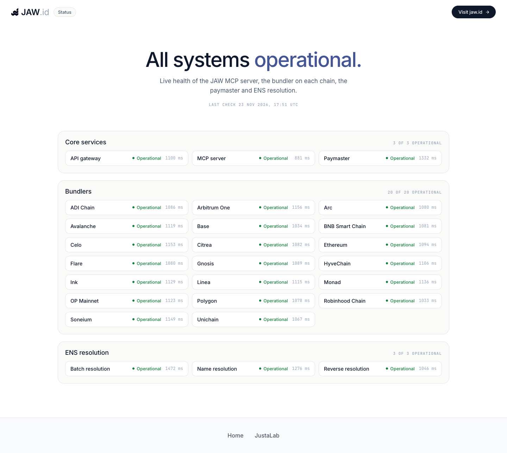
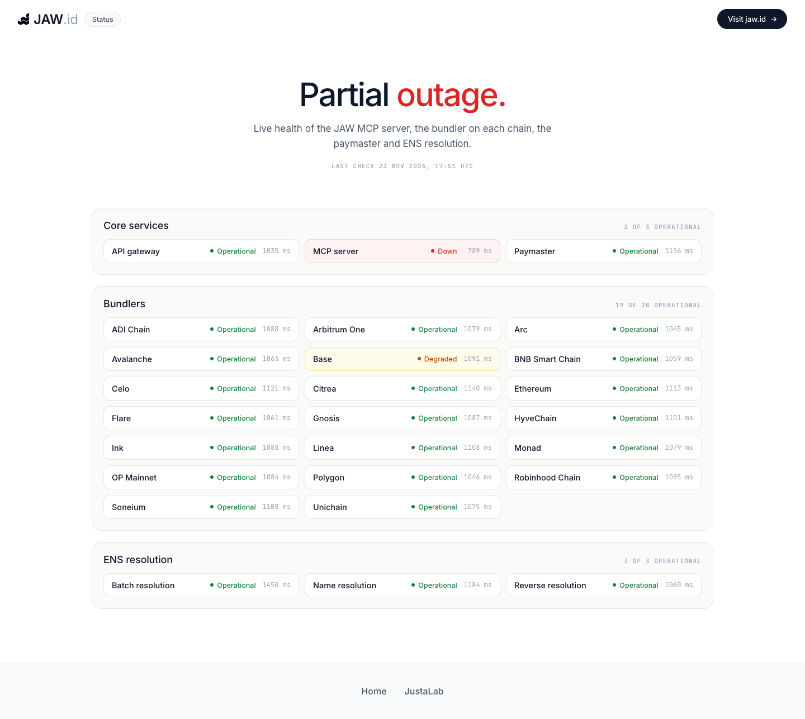

# JustaName Status Page

Public status page for **health.justaname.id**. It shows whether the JAW MCP server, the bundler on each chain, the paymaster and ENS resolution are up, degraded or down, with a 99.9% monthly uptime target.

[Gatus](https://github.com/TwiN/gatus) runs the checks, keeps the history and sends the Slack alerts, and stays internal. A small page in `web/` reads the Gatus API and shows only the state and latency of each check, in the jaw.id look. Everything runs on a DigitalOcean droplet, **outside** the AWS/EKS infra it monitors, so the status page stays up to report an outage instead of going down with it.



## Checks

| Group | Check | Endpoint | Asserts |
|-------|-------|----------|---------|
| Core services | API gateway | `GET /.well-known/x402.json` | server up (public, no auth/RPC) |
| Core services | MCP server | `GET https://mcp.jaw.id/api/health` | `db == ok` and `paused == false` |
| Core services | Paymaster | `POST /proxy/v1/rpc/erc20-paymaster?chainId=8453` `jaw_getTokenQuotes` | returns a USDC quote on Base |
| Bundlers | one per chain, the 20 mainnets jaw.id lists | `POST /proxy/v1/rpc?chainId=…` `eth_chainId` | returns the right hex chainId |
| ENS resolution | Name resolution | `GET /ens/v2/resolve?ens=…` | `viaUniversalResolver==true`, correct `ens` |
| ENS resolution | Batch resolution | `GET /ens/v2/resolve?ens=a&ens=b` | array response, first `ens` correct |
| ENS resolution | Reverse resolution | `GET /ens/v2/reverse?address=…&coinType=60` | resolves without error |

The resolution checks assert **correctness, not just a 200**: `viaUniversalResolver`
is only `true` when the request actually went through the Universal Resolver /
CCIP-Read path, so a gateway returning 200 with garbage still counts as down.

## Public vs internal

The public page takes the latest result of each check and shows one state. Up means every condition passed. Degraded means the answer was right but slower than the internal limit. Down is anything else, such as an error, a wrong status or a wrong body.

The page never shows URLs, conditions, thresholds, errors or alert routing. Those stay in Gatus, whose dashboard and API are only reachable over an SSH tunnel. [docs/SPEC.md](./docs/SPEC.md) has the full rules.

This is how a partial outage reads, here with the MCP server down and the Base bundler degraded:



Mobile views of both states are in [docs/screenshots](./docs/screenshots).

## Cost — effectively $0

- **Liveness**: static JSON, no auth, no RPC. Free.
- **Resolution** (resolve/batch/reverse): we pass a **free public RPC**
  (PublicNode) via `X-Rpc-Url`, so the on-chain compute is paid by the public
  node, **not JustaName's dRPC account**. No api key either (free BYO-rpc path).
- **Bundler**: `eth_chainId` is answered locally by the bundler (never reaches
  dRPC). The only cost is the api-key validation the guard runs per request —
  internal load, not money. Runs every 5min to keep that minimal.
- **MCP server**: `/api/health` reads one settings row. Free.
- **Paymaster**: one USDC quote every 5min, through the same api key. Each quote reads current prices once, from CoinGecko or a Chainlink feed depending on the paymaster's config.

So the whole page costs ~$0 in RPC/spend; the only thing to watch is the api
key's own quota for the bundler checks.

## Intervals

API gateway 30s (free, fast full-outage detector), MCP server 60s (free), everything else 5min. The resolution checks lean on a free public RPC, so we don't probe it aggressively, and the 20 bundler checks each cost an api-key validation.

## Deploy

See **[DEPLOY.md](./DEPLOY.md)** for the full DigitalOcean walkthrough (droplet,
DNS, secrets, TLS). Short version:

```bash
git clone https://github.com/JustaName-id/status-page.git && cd status-page
cp .env.example .env     # fill in RPC_URL, KNOWN_NAME(_2), KNOWN_ADDRESS, BUNDLER_API_KEY, SLACK_WEBHOOK_URL
docker compose up -d --build   # Gatus, the public page and Caddy (auto-HTTPS for health.justaname.id)
```

## Local preview

```bash
cp .env.example .env
docker compose -f docker-compose.local.yml up --build   # page on :3000, Gatus dashboard on :8080, no TLS
```

Probes still hit prod, so you see real results. History here is throwaway.

## Public page development

```bash
cd web
pnpm install
pnpm lint && pnpm typecheck && pnpm test && pnpm build
GATUS_URL=http://localhost:8080 pnpm start   # http://localhost:3000
```

Dependencies install through pnpm with a 7-day minimum release age (`web/pnpm-workspace.yaml`). CI runs the same four commands and boots Gatus with `config.yaml`.

## Multi-region (for the 99.9% SLA)

Run instances in 2+ regions and confirm "down" from more than one vantage point.
For unified history across regions, switch `storage` to Postgres (commented
block in `config.yaml`).

## Files

- `config.yaml`: Gatus checks, thresholds and alerting (internal)
- `web/`: the public page (Hono, TypeScript, server-rendered)
- `docker-compose.yml`: Gatus, the public page and Caddy (prod, auto-HTTPS)
- `docker-compose.local.yml`: Gatus and the public page (preview)
- `Caddyfile`: reverse proxy to the public page, Let's Encrypt for `health.justaname.id`
- `.env.example`: required environment variables
- `docs/SPEC.md`: checks, state rules, public vs internal split, visual tokens
